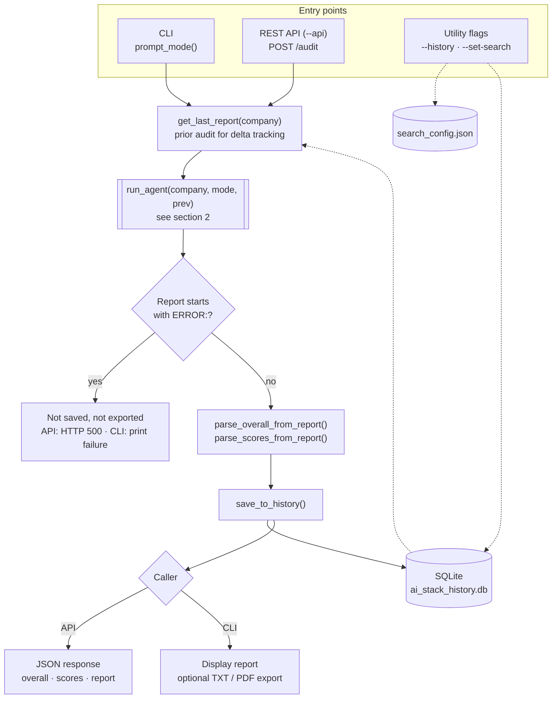
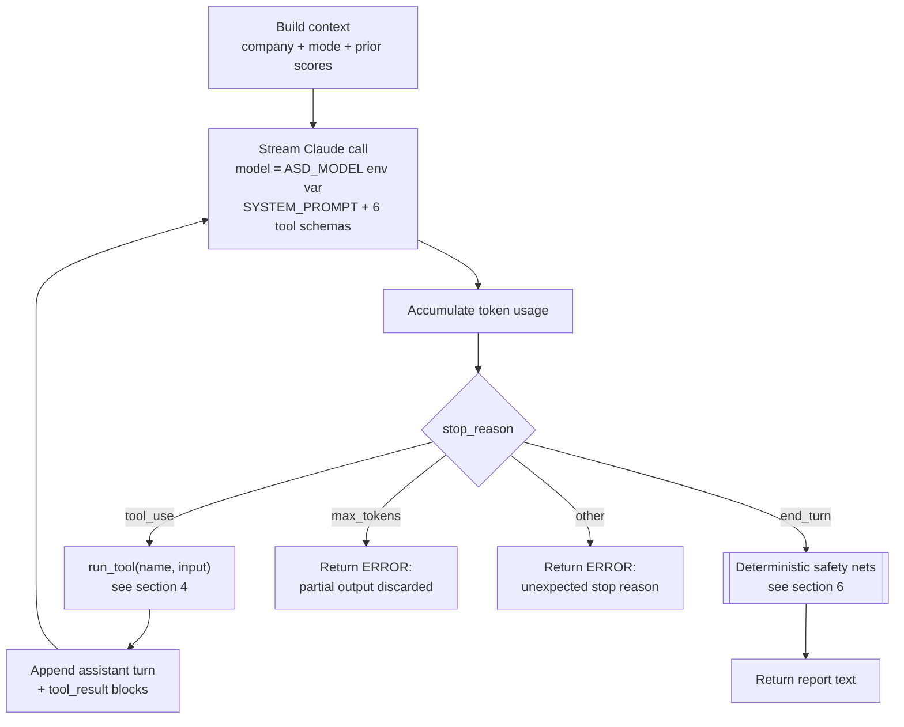
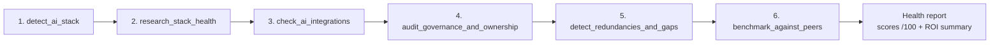
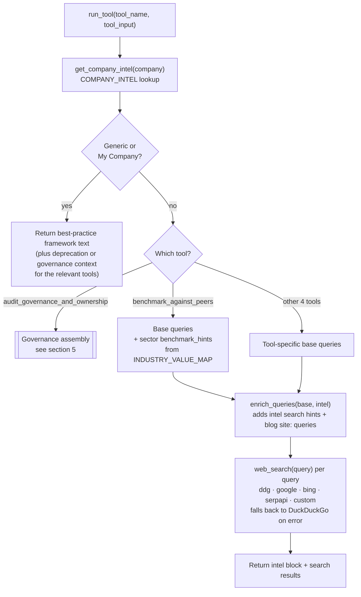
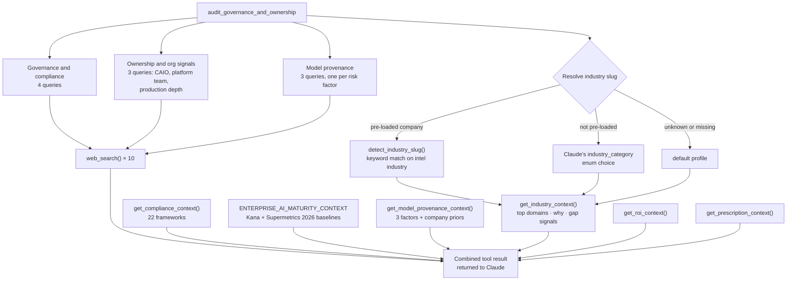
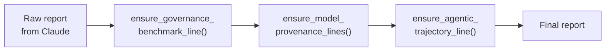
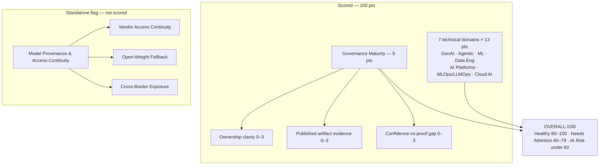

# AI Stack Doctor — Architecture

This document maps how AI Stack Doctor runs an audit, from entry point to saved report. Diagrams are written in Mermaid and render natively on GitHub.

> Reflects `ai_stack_health_agent_v3.py` on `main` (v4.1 REWIRED Edition, Oct 2026). Update these diagrams when the audit pipeline changes.

## 1. Top-level flow

Audit modes selected in `prompt_mode()` or the API body: `own` (internal-facing recommendations), `competitor`, and `generic` (scored against best-practice benchmarks).

`parse_overall_from_report()` anchors on the `OVERALL: NN/100` line followed by its health emoji, so a "Previous Overall" mention in the delta section is never mistaken for the current score.

## 2. Agent loop — `run_agent()`

The model defaults to `claude-sonnet-4-6` when `ASD_MODEL` is unset. Token usage (calls, input, output, cache reads and writes) is logged to stderr when the loop exits, whether it succeeded or not.

## 3. Mandatory tool sequence

`SYSTEM_PROMPT` instructs Claude to call the six audit tools in this order before writing the report.

## 4. Tool execution — `run_tool()`

## 5. Governance assembly — `audit_governance_and_ownership`

This tool returns the richest context of the six. It runs ten searches, one slot for each query, grouped into three themes, and stacks six context blocks in front of the results.

## 6. Deterministic safety nets

Prompt instructions alone have occasionally failed to surface required content. Before `run_agent()` returns, the report passes through three post-processors in order. Each checks whether the model already included the content and inserts a clearly labelled fallback only if it didn't.

| Safety net | Checks for | Scope of the check | If missing, inserts |
|---|---|---|---|
| `ensure_governance_benchmark_line()` | Both "Kana" and "Supermetrics" cited | Governance section only | Benchmark Comparator note after the Governance heading |
| `ensure_model_provenance_lines()` | Each of the 3 factors paired with Low / Medium / High / Unknown within 200 chars, never past the next factor | Governance section only | Each missing factor recorded as **Unknown** |
| `ensure_agentic_trajectory_line()` | "33%" and "routine decisions" together | Whole report | Forward-looking Kana 2026 note after the Strategic Recommendations heading |

The governance section is bounded by the next heading listed in `_SECTIONS_AFTER_GOVERNANCE`, so a citation that appears only in Peer Benchmarking doesn't count as present in Governance. Each net prints a warning to the console when it fires.

## 7. Scoring model

Each provenance factor gets exactly one rating: Low, Medium, High, or Unknown. **Unknown** means nothing is publicly known about the dependency. A visible dependency whose mitigation is undisclosed rates Medium or High, never Unknown. These ratings never feed the Governance Maturity /9 sub-scores.

## 8. Knowledge layers

| Layer | Source | Used by |
|---|---|---|
| Company intelligence | `COMPANY_INTEL` | Every tool (pre-loaded stack signals, search hints, engineering blogs) |
| Compliance catalog | `GLOBAL_COMPLIANCE` | `audit_governance_and_ownership` |
| Enterprise maturity baselines | `ENTERPRISE_AI_MATURITY_CONTEXT` | `audit_governance_and_ownership` → Governance Maturity /9 |
| Model provenance | `MODEL_PROVENANCE_RISK_FACTORS` | `audit_governance_and_ownership` → provenance flag |
| Industry value map | `INDUSTRY_VALUE_MAP` (10 sectors + default) | Governance (prescription weighting) and `benchmark_against_peers` (sector hints) |
| ROI framework | `ROI_FRAMEWORK` | `audit_governance_and_ownership` → Executive ROI Summary |
| Deprecation risk | `DEPRECATION_RISK_CATEGORIES` | `research_stack_health` (generic mode) |
| Maturity calibration | Inline in `SYSTEM_PROMPT` | Peer Benchmarking and AI Org Health (incl. Scaling Purgatory flag) |

## 9. REST API endpoints

| Method | Path | Purpose |
|---|---|---|
| GET | `/health` | Liveness check |
| POST | `/audit` | Run an audit: `{ "company": "...", "mode": "competitor" }`. Returns 500 if generation fails |
| GET | `/history` | List past audits (`?company=`, `?limit=`) |
| GET | `/history/<id>` | Fetch one saved report |
| GET | `/companies` | List companies with pre-loaded intelligence |
| POST | `/api/set-search-engine` | Set search engine and credentials |
