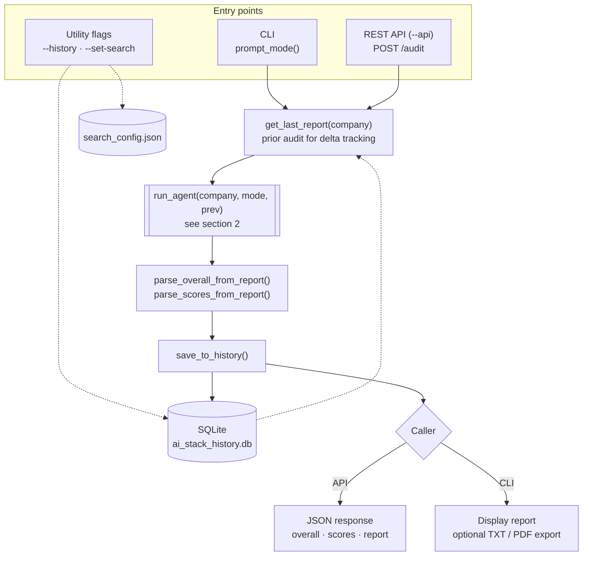
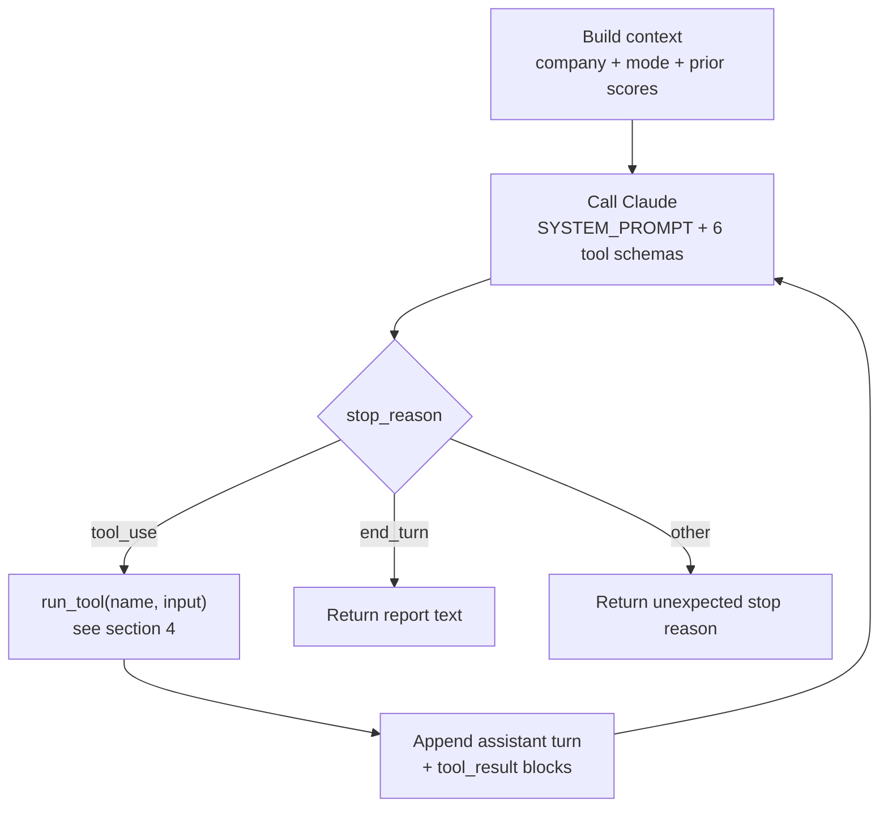
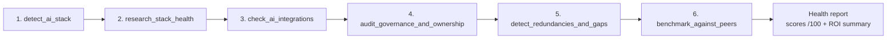
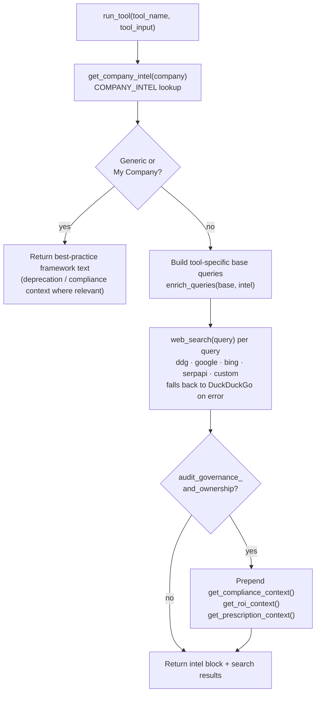

# AI Stack Doctor — Architecture

This document maps how AI Stack Doctor runs an audit, from entry point to saved report. Diagrams are written in Mermaid and render natively on GitHub.

> Reflects `ai_stack_health_agent_v3.py` (v3 core + v4 ROI layer). Update these diagrams when the audit pipeline changes.

## 1. Top-level flow

Audit modes selected in `prompt_mode()` or the API body: `own` (internal-facing recommendations), `competitor`, and `generic` (scored against best-practice benchmarks).

## 2. Agent loop — `run_agent()`

## 3. Mandatory tool sequence

`SYSTEM_PROMPT` instructs Claude to call the six audit tools in this order before writing the report.

## 4. Tool execution — `run_tool()`

## 5. Knowledge layers

| Layer | Source | Used by |
|---|---|---|
| Company intelligence | `COMPANY_INTEL` | Every tool (pre-loaded stack signals for top-tier companies) |
| Compliance catalog | `GLOBAL_COMPLIANCE` | `audit_governance_and_ownership` |
| ROI framework | `ROI_FRAMEWORK` | `audit_governance_and_ownership` → Executive ROI Summary |
| Prescriptions | `PRESCRIPTION_PRIORITY`, `QUICK_WIN_EXAMPLES` | `audit_governance_and_ownership` |
| Deprecation risk | `DEPRECATION_RISK_CATEGORIES` | `research_stack_health` (generic mode) |

## 6. REST API endpoints

| Method | Path | Purpose |
|---|---|---|
| GET | `/health` | Liveness check |
| POST | `/audit` | Run an audit: `{ "company": "...", "mode": "competitor" }` |
| GET | `/history` | List past audits (`?company=`, `?limit=`) |
| GET | `/history/<id>` | Fetch one saved report |
| GET | `/companies` | List companies with pre-loaded intelligence |
| POST | `/api/set-search-engine` | Set search engine and credentials |
